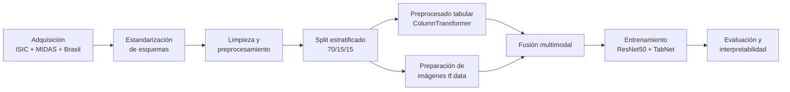
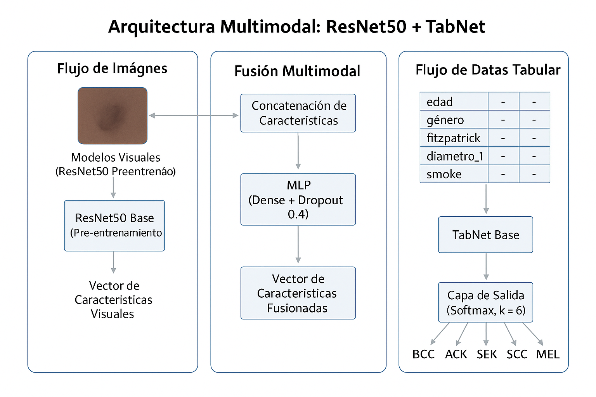
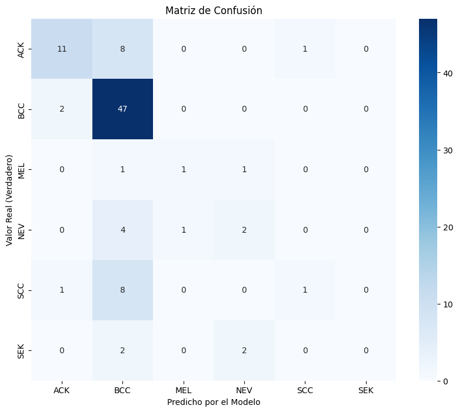

# Detección Multimodal de Cáncer de Piel con Deep Learning

> Sistema de clasificación de lesiones cutáneas que combina **imágenes dermatoscópicas** y **datos clínicos tabulares** mediante arquitecturas multimodales (ResNet50 + TabNet), con énfasis en la equidad diagnóstica para **tipos de piel Fitzpatrick III–VI**.

[](https://www.python.org/)
[](https://www.tensorflow.org/)
[](https://keras.io/)
[](LICENSE)

---

## 📋 Tabla de contenidos

- [Descripción del problema](#-descripción-del-problema)
- [Motivación](#-motivación)
- [Datasets](#-datasets)
- [Arquitectura del proyecto](#-arquitectura-del-proyecto)
- [Pipeline metodológico](#-pipeline-metodológico)
- [Modelos evaluados](#-modelos-evaluados)
- [Resultados](#-resultados)
- [Interpretabilidad](#-interpretabilidad)
- [Estructura del repositorio](#-estructura-del-repositorio)
- [Instalación](#-instalación)
- [Uso](#-uso)
- [Despliegue en HPC](#️-despliegue-en-hpc)
- [Tests](#-tests)
- [Referencias](#-referencias)
- [Licencia](#-licencia)

---

## Descripción del problema

La detección temprana del cáncer de piel es uno de los problemas más estudiados en visión computacional médica. Sin embargo, la mayoría de los sistemas existentes se entrenan con poblaciones predominantemente de piel clara (Fitzpatrick I–II), lo que genera un **sesgo racial documentado**: los modelos rinden significativamente peor en pacientes de piel oscura, donde además el diagnóstico clínico es más difícil.

Este proyecto aborda el problema como una tarea de **clasificación multimodal multiclase**:

- **Entrada 1:** imagen dermatoscópica de la lesión (256×256×3).
- **Entrada 2:** 29 características clínicas tabulares (edad, sexo, antecedentes, síntomas, tipo de piel, región anatómica, etc.).
- **Salida:** diagnóstico entre 6 clases: `ACK`, `BCC`, `MEL`, `NEV`, `SCC`, `SEK`.

## Motivación

1. **Equidad en salud:** los modelos de IA dermatológica muestran menor sensibilidad en pieles oscuras. Al filtrar y ponderar los datos hacia Fitzpatrick III–VI, el sistema se especializa en la población históricamente subrepresentada.
2. **Fusión de información clínica:** la imagen por sí sola no captura antecedentes familiares, síntomas (picor, sangrado, crecimiento) ni factores de riesgo. La fusión con datos tabulares (vía TabNet) aporta contexto clínico complementario.
3. **Reproducibilidad:** pipeline completo documentado, desde la adquisición de datos hasta la evaluación e interpretabilidad.

## Datasets

| Dataset                        | Origen                                            | Tamaño aprox.  | Uso                                                                |
| ------------------------------ | ------------------------------------------------- | --------------- | ------------------------------------------------------------------ |
| **ISIC 2020**            | International Skin Imaging Collaboration          | ~33k imágenes  | Fuente de melanomas en palmas/plantas (proxy de piel oscura)       |
| **MIDAS (Stanford)**     | Multimodal Image Dataset for AI-based Skin Cancer | ~10k imágenes  | Datos multimodales con escala Fitzpatrick explícita               |
| **PAD-UFES-20 (Brasil)** | Universidad Federal de Espírito Santo            | ~2.3k imágenes | **Dataset principal de entrenamiento** (Fitzpatrick III–VI) |

> Los datos no se incluyen en el repositorio por su tamaño y restricciones de uso. Las instrucciones de descarga están en [`docs/datasets.md`](docs/datasets.md).

## Pipeline metodológico



### 1. Adquisición y estandarización (`01_getting_data.ipynb`)

- Carga de los tres datasets con esquemas distintos.
- Filtro por escala Fitzpatrick (III–VI) en MIDAS y Brasil.
- Proxy para ISIC: melanomas en palmas/plantas como proxy de piel oscura.
- Estandarización de columnas, diagnósticos (abreviaturas `MEL`, `BCC`, …) y regiones anatómicas a un esquema común de 8 columnas.

### 2. Limpieza y preprocesamiento (`02_data_cleaning_brasil.ipynb`)

- Análisis de valores faltantes y estrategia de imputación.
- Split estratificado **70% / 15% / 15%** (train/val/test).
- Pipeline de preprocesado con `sklearn`:
  - Categóricas de alto cardinal → **OneHotEncoder**.
  - Categóricas de bajo cardinal → **imputación + `BestBinarySplitter`** (transformador propio que busca la partición binaria que maximiza la ganancia de Gini/entropía).
  - Numéricas → **StandardScaler**.
- Balanceo de clases por re-muestreo (oversampling/undersampling por clase).
- Persistencia del estado procesado en `preprocessed_multimodal/`.

### 3. Modelado (`03_developing_models.ipynb`)

- Datasets de alto rendimiento con `tf.data` (decodificación paralela, prefetch, aumentación GPU).
- Evaluación de 5 arquitecturas multimodales (ver tabla abajo).
- Estrategia de entrenamiento: base congelada → ajuste de cabezal → **fine-tuning** de las últimas capas con LR bajo.
- Callbacks: `ModelCheckpoint` (mejor F1 macro), `EarlyStopping`, `ReduceLROnPlateau`, TensorBoard.

### 4. Evaluación e interpretabilidad (`04_best_models_evaluation.ipynb`)

- Reporte de clasificación y matriz de confusión sobre el set de prueba.
- **Análisis de error por tipo de piel Fitzpatrick** (tasa de error por nivel).
- **Grad-CAM** sobre la rama de visión para visualizar qué regiones de la imagen impulsan la predicción.
- **Máscaras de atención de TabNet** para la importancia de las features tabulares.

## Modelos evaluados

| # | Arquitectura                        | Rama de visión                   | Rama tabular   |
| - | ----------------------------------- | --------------------------------- | -------------- |
| 1 | ResNet50 + TabNet                   | ResNet50 (ImageNet, congelada)    | TabNet encoder |
| 2 | CNN básica + MLP                   | 3 bloques Conv+Pool propios       | MLP (4 capas)  |
| 3 | Xception + TabNet                   | Xception (ImageNet, congelada)    | TabNet encoder |
| 4 | Xception + MLP                      | Xception (ImageNet, congelada)    | MLP (4 capas)  |
| 5 | ResNet50V2 + TabNet                 | ResNet50V2 (ImageNet, congelada)  | TabNet encoder |
| 6 | **ResNet50 + TabNet (final)** | ResNet50 (ImageNet) + fine-tuning | TabNet encoder |

**Modelo ganador:** `ResNet50 + TabNet` — la combinación de la base preentrenada con el encoder TabNet (atención sobre features tabulares) superó a las variantes con MLP y a las bases alternativas.


*Arquitectura del modelo ganador: fusión de la rama de visión (ResNet50 preentrenado) y la rama tabular (TabNet) mediante concatenación de características.*

## Resultados

- **F1 macro en validación:** ~0.72 (modelo final con fine-tuning).
- **AUC en validación:** ~0.89.
- El análisis de error por Fitzpatrick permite cuantificar la equidad del sistema a lo largo de la escala de piel.


*Matriz de confusión sobre el set de prueba. Se observa una fuerte tendencia a predecir `BCC`, lo que refleja el desbalance de clases y se analiza en el análisis de error por Fitzpatrick.*

> Los logs completos de entrenamiento (TensorBoard) se encuentran en `my_logs/`. Las figuras de resultados (matriz de confusión, arquitecturas) están en `img_in_exp/` y `Documentation/`.

## Interpretabilidad

- **Grad-CAM:** heatmap de las capas convolucionales finales de ResNet50 para explicar predicciones a nivel de imagen.
- **Máscaras de TabNet:** importancia agregada de cada feature clínica según las máscaras de atención del encoder.

## Estructura del repositorio

```
Project-ComputerVision/
├── README.md
├── LICENSE
├── requirements.txt              # Dependencias (pip)
├── environment.yml               # Entorno conda (para HPC)
├── pyproject.toml                # Metadatos del proyecto + config de lint
├── Makefile                      # Atajos de desarrollo y HPC
├── config.py                     # Configuración central (paths, hiperparámetros)
├── .github/
│   └── workflows/
│       └── ci.yml                # CI: lint + tests en GitHub Actions
├── Code/
│   ├── 01_getting_data.ipynb     # Adquisición y estandarización de datasets
│   ├── 02_data_cleaning_brasil.ipynb  # Limpieza y preprocesamiento
│   ├── 03_developing_models.ipynb     # Entrenamiento de arquitecturas
│   └── 04_best_models_evaluation.ipynb# Evaluación e interpretabilidad
├── functions/                    # Paquete de utilidades reutilizables
│   ├── __init__.py
│   ├── config_dataframe.py       # BestBinarySplitter y utilidades de categóricas
│   ├── deep_learning_add.py      # Bloques SE (Squeeze-and-Excitation)
│   ├── xception_model.py         # Arquitectura Xception desde cero
│   ├── multimodal_config.py      # Generador de datos multimodal
│   └── multimodal_xception.py    # Modelo Xception multimodal
├── scripts/
│   └── slurm/                    # Scripts SLURM para HPC
│       ├── 01_prepare_data.sh    #   Etapa 1: preparación (CPU)
│       ├── 03_train_models.sh    #   Etapa 2: entrenamiento (GPU)
│       └── 04_evaluate.sh        #   Etapa 3: evaluación (GPU)
├── tests/                        # Tests unitarios (pytest)
│   ├── conftest.py
│   ├── test_config_dataframe.py
│   └── test_utilidades.py
├── docs/
│   ├── datasets.md               # Cómo obtener los datasets
│   ├── results.md                # Resumen de resultados
│   └── hpc.md                    # Guía de despliegue en HPC
├── models/                       # Modelos Keras entrenados (.keras)
├── preprocessed_multimodal/      # Estado de datos procesados (.pkl)
├── Data/                         # Datasets (no versionados, ver docs/datasets.md)
├── Data_fast/                    # TFRecords para entrenamiento rápido
├── my_logs/                      # Logs de TensorBoard
├── img_in_exp/                   # Figuras de resultados
└── Documentation/                # Papers de referencia
```

## Instalación

Requisitos: Python 3.10+, GPU con CUDA (recomendado para entrenamiento).

```bash
# 1. Clonar el repositorio
git clone <url-del-repositorio>
cd Project-ComputerVision

# 2. Crear y activar el entorno virtual
python -m venv .venv
# Windows:
.venv\Scripts\activate
# Linux/macOS:
source .venv/bin/activate

# 3. Instalar dependencias
pip install -r requirements.txt
```

## Uso

El flujo de trabajo se ejecuta en orden, notebook por notebook:

| Paso | Notebook                                 | Descripción                                   |
| ---- | ---------------------------------------- | ---------------------------------------------- |
| 1    | `Code/01_getting_data.ipynb`           | Carga y estandariza los 3 datasets             |
| 2    | `Code/02_data_cleaning_brasil.ipynb`   | Limpieza, split y preprocesamiento             |
| 3    | `Code/03_developing_models.ipynb`      | Entrena las arquitecturas multimodales         |
| 4    | `Code/04_best_models_evaluation.ipynb` | Evalúa el mejor modelo y genera explicaciones |

También puedes usar los atajos del `Makefile`:

```bash
make install   # instala dependencias
make test      # ejecuta los tests unitarios
make lint      # ejecuta el linter
make clean     # limpia artefactos temporales
```

> **Nota:** los notebooks son **portables** (local / Colab / HPC). Cada uno empieza con una celda de configuración que detecta el entorno y define `PROJECT_ROOT`, por lo que no hay rutas duras que ajustar.✅ Tests

El código propio (transformador `BestBinarySplitter`, utilidades) cuenta con tests unitarios:

```bash
pytest tests/ -v
```

La CI en GitHub Actions ejecuta lint (ruff), formato (black) y tests en cada push/PR.

## Referencias

Los papers de referencia (revisiones de segmentación/clasificación de lesiones cutáneas, TabNet, Xception, sesgo racial en IA dermatológica) se encuentran en [`Documentation/`](Documentation/).

## Licencia

Distribuido bajo la licencia MIT. Ver [LICENSE](LICENSE).
