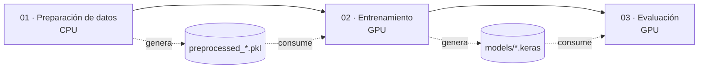

# Despliegue en HPC (High Performance Computing)

Guía para llevar el proyecto a un cluster HPC con **SLURM** (el scheduler más
común). El entrenamiento de las arquitecturas multimodales es la etapa más
costosa y es donde el HPC aporta el mayor valor (GPU + memoria + tiempo).

> **Nota:** los scripts de SLURM en [`scripts/slurm/`](../scripts/slurm/) son
> plantillas. Ajusta las directivas `#SBATCH` (partición, memoria, tiempo,
> GPUs) y la ruta `CONDA_ROOT` a las especificaciones de **tu** cluster.

## 1. Flujo de trabajo

El pipeline se divide en tres etapas secuenciales, cada una un job SLURM:



| Etapa | Script | Recurso | Salida |
|---|---|---|---|
| 1. Preparación | `scripts/slurm/01_prepare_data.sh` | CPU | `preprocessed_multimodal/*.pkl` |
| 2. Entrenamiento | `scripts/slurm/03_train_models.sh` | GPU | `models/*.keras` |
| 3. Evaluación | `scripts/slurm/04_evaluate.sh` | GPU | `img_in_exp/*.png` + métricas |

## 2. Preparación del entorno

### Opción A — Con acceso a internet en el HPC

```bash
# 1. Clona el repositorio en tu espacio de trabajo
git clone <url-del-repositorio> Project-ComputerVision
cd Project-ComputerVision

# 2. Crea el entorno conda
conda env create -f environment.yml
conda activate skin-cancer
```

### Opción B — Sin internet (típico en HPC)

Empaqueta el entorno en tu máquina local y transfiérelo:

```bash
# --- En tu máquina local ---
conda env create -f environment.yml
conda pack -n skin-cancer -o skin-cancer-env.tar.gz

# Transfiere el repo + el paquete al HPC
scp -r Project-ComputerVision skin-cancer-env.tar.gz usuario@hpc:~/

# --- En el HPC ---
mkdir -p ~/skin-cancer-env
tar -xzf skin-cancer-env.tar.gz -C ~/skin-cancer-env
source ~/skin-cancer-env/bin/activate
```

> Si el HPC usa **módulos** (`module load`) en lugar de conda, instala
> TensorFlow y CUDA como módulos del sistema y omite el entorno conda.

## 3. Envío de jobs

```bash
# Etapa 1: preparación de datos (CPU)
sbatch scripts/slurm/01_prepare_data.sh

# Etapa 2: entrenamiento (GPU) — espera a que termine la etapa 1
sbatch scripts/slurm/03_train_models.sh

# Etapa 3: evaluación (GPU) — espera a que termine la etapa 2
sbatch scripts/slurm/04_evaluate.sh
```

### Comandos útiles de SLURM

```bash
squeue -u $USER          # ver tus jobs en cola
sacct -j <jobid>         # estado y recursos de un job
scancel <jobid>          # cancelar un job
scontrol show partition  # ver particiones disponibles
```

## 4. Ajustes por cluster

Cada HPC tiene convenciones distintas. Revisa con tu administrador:

- **Particiones:** nombre de las particiones CPU/GPU (`--partition=`).
- **GPU:** sintaxis de `--gres` (p. ej. `gpu:1`, `a100:1`, `gpu:a100:1`).
- **Módulos:** `module load cuda/12.x`, `module load gcc/12.x`, etc.
- **Límites:** memoria máxima por nodo, tiempo máximo por job.
- **Sistema de archivos:** usa tu espacio de trabajo (`$HOME` o `/scratch`)
  para datos y modelos, no el sistema.

## 5. Buenas prácticas

- **Datos en almacenamiento rápido:** copia `Data/` a `/scratch` o similar
  antes de entrenar; leer imágenes desde almacenamiento de red es lento.
- **Jobs largos:** si el entrenamiento supera el tiempo máximo del cluster,
  divide por epochs usando `initial_epoch` (el notebook 03 ya lo soporta).
- **Reproducibilidad:** fija la semilla (`CFG.SEED` en [`config.py`](../config.py))
  y registra la versión de TensorFlow en los logs.
- **Logs:** los scripts escriben en `logs/`; los logs de TensorBoard van a
  `my_logs/`.

## 6. Verificación rápida (sin GPU)

Para validar el código y los tests **sin** recursos de entrenamiento:

```bash
conda activate skin-cancer
pytest tests/ -v          # tests unitarios (CPU, rápido)
ruff check functions/ config.py tests/
```

Estos comandos solo requieren CPU y son ideales para CI o para verificar que
el entorno está bien antes de enviar jobs de GPU.
